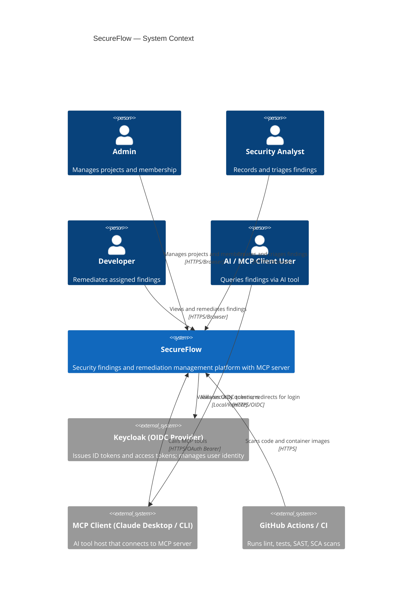
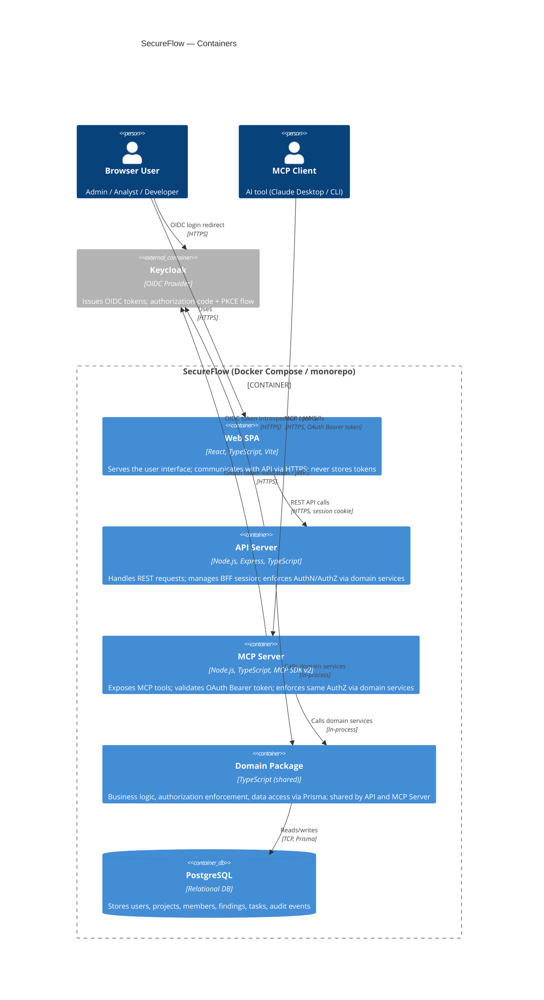
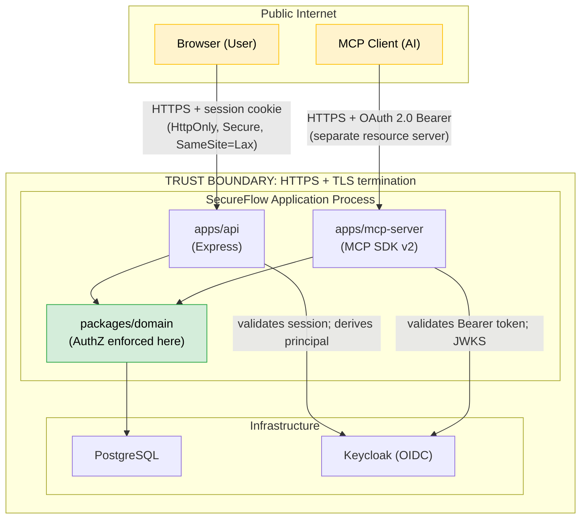
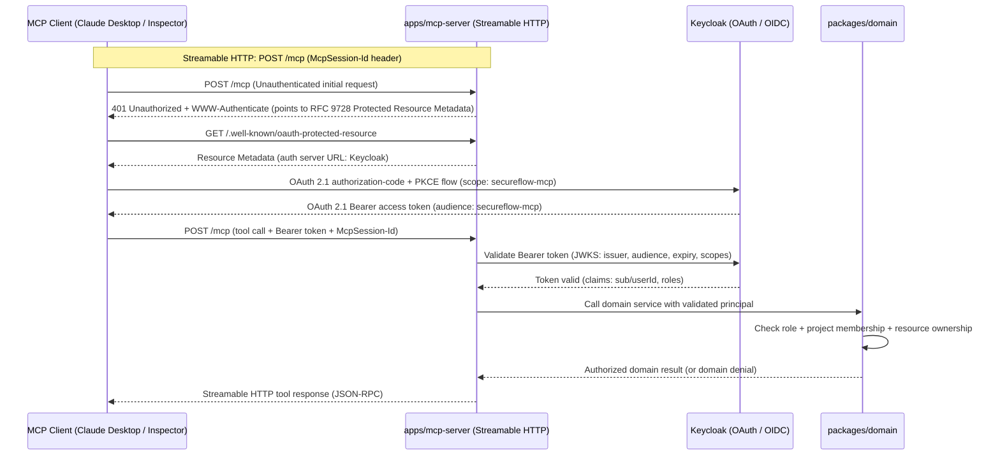
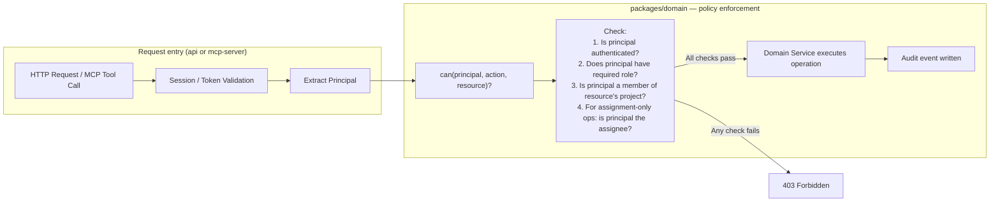

# SecureFlow — Architecture

**Document version:** 1.0 — 2026-10-15  
**Status:** Draft — pending Phase 1 gate approval  
**Related docs:** [Product Requirements](01-product-requirements.md) · [Data Model](03-data-model.md) · [ADR 0001](decisions/0001-modular-monolith.md) · [PROJECT_ROADMAP.md §2](../PROJECT_ROADMAP.md)

---

## 1. Architectural Pattern

SecureFlow uses a **modular monolith** (see [ADR 0001](decisions/0001-modular-monolith.md)). A single deployable API process serves both REST and MCP endpoints. All business logic and authorization lives in a shared `packages/domain` library imported by both `apps/api` and `apps/mcp-server`. The browser client is a separate Vite/React SPA.

The key architectural constraint is:

> **`apps/api` and `apps/mcp-server` are both thin adapters. Neither contains authorization logic. Both call `packages/domain` service functions for all business operations.**

---

## 2. System Context Diagram



---

## 3. Container / Service Diagram



---

## 4. Monorepo Boundaries

```text
secureflow-mcp-appsec-platform/
├── apps/
│   ├── web/               # React + Vite SPA (TypeScript)
│   │   └── src/
│   ├── api/               # Express REST API (TypeScript)
│   │   └── src/
│   │       ├── routes/    # Thin HTTP route handlers only
│   │       ├── middleware/ # Auth session, rate limiting, error handling
│   │       └── server.ts
│   └── mcp-server/        # MCP server (TypeScript, MCP SDK v2)
│       └── src/
│           ├── tools/     # Thin tool handlers only
│           └── server.ts
├── packages/
│   ├── domain/            # Authorization + business logic + data access (Prisma)
│   │   └── src/
│   │       ├── services/  # FindingService, ProjectService, AuditService, etc.
│   │       ├── policy/    # Authorization checks: can(actor, action, resource)?
│   │       └── db/        # Prisma client wrapper + repository functions
│   ├── schemas/           # Zod schemas: shared between web, api, mcp-server
│   └── shared/            # Common types, error classes, utilities
├── docs/
│   ├── decisions/
│   ├── security/
│   └── screenshots/       # Real screenshots added in Phase 5+
├── infra/
│   ├── docker/
│   └── zap/
├── tests/
│   ├── e2e/               # Playwright tests
│   └── security/          # Manual AppSec test scripts and evidence
├── .github/
│   └── workflows/
├── PROJECT_ROADMAP.md
├── ANTIGRAVITY_FIRST_PROMPT.md
└── compose.yaml
```

### Import Policy (enforced in Phase 2)

| Package | May import from | May NOT import from |
|---|---|---|
| `apps/web` | `packages/schemas`, `packages/shared` | `packages/domain` (server-only), `apps/api`, `apps/mcp-server` |
| `apps/api` | `packages/domain`, `packages/schemas`, `packages/shared` | `apps/web`, `apps/mcp-server`, `packages/domain/src/db/*` (must use service layer) |
| `apps/mcp-server` | `packages/domain`, `packages/schemas`, `packages/shared` | `apps/web`, `apps/api`, `packages/domain/src/db/*` (must use service layer) |
| `packages/domain` | `packages/schemas`, `packages/shared` | `apps/*` (never reverse-import) |
| `packages/schemas` | `packages/shared` | `apps/*`, `packages/domain` |

#### Sub-Path Enforcement within `packages/domain`
`apps/api` and `apps/mcp-server` must import only from `packages/domain/src/services/` (or the top-level barrel `packages/domain`) — **never** directly from `packages/domain/src/db/` (repository layer).
- Enforced by: TypeScript package exports in `packages/domain/package.json` exposing only service entry points, and `eslint-plugin-boundaries` pattern rules prohibiting imports from `*/domain/src/db/*`.
- Verification (Phase 2): A test import of `packages/domain/src/db/FindingRepository` from `apps/api` must trigger a linter/compiler error.


---

## 5. Trust Boundaries



### Trust Levels

| Component | Trust Level | Notes |
|---|---|---|
| PostgreSQL | High (internal) | Accessible only from the application process; not exposed externally |
| Keycloak | High (internal in dev) | Trusted identity provider; tokens validated via JWKS |
| `packages/domain` | High | Only enforcement point; all data access goes through here |
| `apps/api` | Medium | Validates session cookie; routes calls to domain; never stores credentials |
| `apps/mcp-server` | Medium | Validates Bearer token; routes calls to domain; never stores credentials |
| Browser | Untrusted | User input, cookies, and form data are always validated server-side |
| MCP Client | Untrusted until token validated | Bearer token is validated server-side; no trust from MCP argument content |
| Finding description content | Untrusted data | Never interpreted as instructions; treated as opaque string |

---

## 6. Browser Session Model (BFF)

SecureFlow uses a **Backend For Frontend (BFF)** session model. The browser never holds an OIDC token.

```mermaid
sequenceDiagram
  participant U as Browser
  participant A as apps/api (BFF)
  participant K as Keycloak (OIDC)
  participant D as packages/domain

  U->>A: GET /auth/login
  A->>K: Redirect — authorization-code flow + PKCE (code_challenge)
  K->>U: Render login form
  U->>K: Submit credentials
  K->>A: Redirect with authorization code
  A->>K: POST /token (code + code_verifier)
  K->>A: ID token + access token (validated: issuer, audience, expiry)
  A->>A: Create server-side session; derive user identity + roles
  A->>U: Set session cookie (HttpOnly, Secure, SameSite=Lax)
  Note over U,A: Browser holds only an opaque session cookie
  U->>A: Subsequent API requests (cookie)
  A->>D: Authenticated domain calls (principal derived server-side)
```

**Security properties:**
- No tokens are stored in `localStorage` or `sessionStorage`.
- `state` parameter prevents CSRF on the OAuth redirect.
- Session cookie is `HttpOnly` (no JS access), `Secure` (HTTPS only in production), `SameSite=Lax`.
- Session expiry and idle timeout are enforced server-side.
- Logout invalidates the server-side session and clears the cookie.
- **XSS co-dependency:** `HttpOnly` protects the cookie value from direct JavaScript theft (`document.cookie`), but does NOT prevent an active XSS script from executing authenticated requests through the browser. The session model strictly depends on defense-in-depth XSS mitigations: restrictive Content Security Policy (§12), prohibition of `dangerouslySetInnerHTML`, and context-aware output encoding.
- **Session membership freshness:** Project membership is resolved dynamically from the database on every authorized request (not baked into static session tokens) to ensure that removal of a project member takes immediate effect, fulfilling OLI-10.
- **Session fixation protection:** The session identifier is regenerated and rotated upon successful OIDC callback before establishing the authenticated session.

**✅ Decision D3 (Approved):** BFF server-managed session model with secure, HttpOnly cookies and server-side state.

---

## 7. MCP Authentication and Authorization Model

The MCP server is a **separate resource server** from the browser-facing API. Its transport is **Streamable HTTP** (using the official TypeScript SDK v2 and `@modelcontextprotocol/express` adapter), replacing the deprecated HTTP+SSE transport. Authentication is entirely distinct from the BFF session and is governed by **OAuth 2.1**.



**Key architectural attributes:**
- **Transport:** Streamable HTTP over a single unified endpoint (`POST /mcp` for requests, conditional `GET /mcp` streaming), sessions tracked via headers (`McpSession-Id`). Fully compatible with reverse proxies and load balancers.
- **Local Dev Alternative:** `stdio` transport is also supported as an execution mode for local subprocess execution with Claude Desktop.
- **Token scope & audience:** Bearer token with audience `secureflow-mcp`. Browser session cookies cannot authenticate against MCP endpoints and vice versa.
- **OAuth 2.1 Compliance:** Implements RFC 9728 Protected Resource Metadata for authorization server discovery. For the controlled local development demo, a pre-configured Keycloak client is provided; RFC 7591 Dynamic Client Registration (DCR) is documented as the standard production client registration mechanism.
- **Authorization enforcement:** Zero business logic in `apps/mcp-server`; all calls delegate to `packages/domain` services which enforce identical authorization policies to the REST API.

**✅ Decision D5 (Approved):** Streamable HTTP transport with official MCP TypeScript SDK v2 (`@modelcontextprotocol/express`) and OAuth 2.1 token validation.


---

## 8. Authorization Architecture



### Authorization Rules (summary — full matrix in [04-authorization-matrix.md](04-authorization-matrix.md))

- **Deny by default.** An explicit allow is required for every action.
- Role alone is not sufficient. Project membership and resource ownership are checked on every request.
- `404 Not Found` is returned when a resource exists but the caller has no visibility — **not** `403 Forbidden` — to prevent existence disclosure.
- The frontend may hide controls the user cannot use, but the API is the authoritative enforcement layer.

---

## 9. API Resource Inventory (draft — finalize after Phase 1 gate)

| Method | Path | Auth Required | Authorized Roles |
|---|---|---|---|
| `GET` | `/auth/login` | No | — |
| `GET` | `/auth/callback` | No | — |
| `POST` | `/auth/logout` | Session | All |
| `GET` | `/api/v1/projects` | Session | Admin, Analyst, Developer |
| `POST` | `/api/v1/projects` | Session | Admin |
| `GET` | `/api/v1/projects/:id` | Session | Admin, Analyst (member), Developer (member) |
| `POST` | `/api/v1/projects/:id/members` | Session | Admin |
| `DELETE` | `/api/v1/projects/:id/members/:userId` | Session | Admin |
| `GET` | `/api/v1/findings` | Session | Admin, Analyst (own projects), Developer (assigned only) |
| `POST` | `/api/v1/findings` | Session | Analyst |
| `GET` | `/api/v1/findings/:id` | Session | Admin, Analyst (own project), Developer (if assigned) |
| `PATCH` | `/api/v1/findings/:id` | Session | Analyst (own project) |
| `POST` | `/api/v1/findings/:id/submit-remediation` | Session | Developer (if assigned) |
| `POST` | `/api/v1/findings/:id/verify` | Session | Analyst (own project) |
| `GET` | `/api/v1/audit-events` | Session | Admin |
| `GET` | `/health/ready` | No | — |

### MCP Tools Inventory

| Tool | Access | Description |
|---|---|---|
| `list_my_findings` | Bearer + AuthZ | List findings the caller is authorized to see |
| `get_finding_details` | Bearer + AuthZ | Get full details of one authorized finding |
| `get_remediation_summary` | Bearer + AuthZ | Get remediation status for an authorized finding |
| `propose_remediation_task` | Bearer + AuthZ | Create a pending action (Phase 6+; not auto-execute) |

### API Design & Contract Notes (Deferred Specifications)
- **Deferred to Phase 3:** API response schema standard (success envelope `{ data: T, meta?: object }` and error shape `{ error: { code: string, message: string, details?: unknown } }`), standard HTTP status code contract (400 validation, 401 unauthenticated, 403 forbidden, 404 resource not found / existence hiding), and API versioning policy (`/api/v1/`).
- **Deferred to Phase 5:** Frontend routing library (React Router v7), route guard architecture for authenticated vs public navigation, and client server-state cache management (TanStack Query v5).

---

## 10. Technology Decisions (Authoritative Stack Pinned for Implementation)

| Concern | Choice | Version Constraint / Notes | Decision Status |
|---|---|---|---|
| Runtime & Language | Node.js + TypeScript | Node.js 24 LTS (Active LTS, pinned ≥24.0.0); TypeScript ≥5.7.0 (stable) | Pinned in `.nvmrc` and `engines` in Phase 2 |
| Database | PostgreSQL | PostgreSQL 17.x | Accepted |
| ORM | Prisma 7 | Prisma 7.x with official PostgreSQL driver adapter (`@prisma/adapter-pg`) | ✅ Approved (D1) |
| OIDC Provider (local dev) | Keycloak | Keycloak 26.x in Docker Compose; supports PKCE and OAuth 2.1 | ✅ Approved (D2) |
| Session model | BFF server-managed session | `express-session`, HttpOnly/Secure/SameSite=Lax cookies, session rotation on login, dynamic DB membership resolution | ✅ Approved (D3) |
| MCP transport | Streamable HTTP | MCP TypeScript SDK v2 (`@modelcontextprotocol/express`); replaces deprecated HTTP+SSE; OAuth 2.1 token validation | ✅ Approved (D5) |
| Monorepo tooling | pnpm workspaces | pnpm ≥9.x workspaces with strict package isolation | Accepted |
| Frontend | React + Vite | React 18/19, Vite 6, TypeScript, TanStack Query v5, React Router v7 | Accepted |
| Backend | Express | Express 5.x on Node.js 24 LTS | Accepted |
| Runtime validation | Zod | Zod 3.x shared between web, api, and mcp-server via `packages/schemas` | Accepted |
| Structured Logging | Pino | Pino with redaction of sensitive credentials, tokens, and session IDs | Accepted |

---

## 11. Why Shared Domain Services Are Necessary

If authorization logic were duplicated between `apps/api` and `apps/mcp-server`:

1. **Divergence risk:** A bug fix or policy change in one would not automatically apply to the other.
2. **Attack surface:** An attacker who finds a policy gap in the MCP path would have equivalent REST functionality protected.
3. **Auditability:** A security reviewer cannot determine authorization correctness without reading both implementations.

By centralizing in `packages/domain`, a single code path is the source of truth for all policy decisions. Both REST and MCP are verified to call the same `can(principal, action, resource)` function.

---

## 12. Security Header Strategy

All HTTP responses from `apps/api` and `apps/mcp-server` shall include:

| Header | Value |
|---|---|
| `Content-Security-Policy` | Restrictive policy for API (no page rendering); relaxed policy for web SPA — to be finalized in Phase 5 |
| `X-Content-Type-Options` | `nosniff` |
| `X-Frame-Options` | `DENY` |
| `Referrer-Policy` | `strict-origin-when-cross-origin` |
| `Strict-Transport-Security` | `max-age=31536000; includeSubDomains` (production only) |
| `Permissions-Policy` | Restrict browser features not needed by the application |

CORS policy for `apps/api`:
- Allow-Origin: `https://app.secureflow.local` (or configured frontend origin) only.
- Credentials: `true` (required for session cookie).
- No wildcard origins.

---

## 13. Architecture Decision Register (Authoritative — 10 Decisions)

The following ten architectural decisions are finalized and govern all implementation phases:

| ID | Concern | Decision | Rationale | Status |
|---|---|---|---|---|
| **D1** | ORM Choice | **Prisma 7** with PostgreSQL driver adapter (`@prisma/adapter-pg`) | Type-safe migrations, PostgreSQL 17 compatibility, schema-as-source-of-truth; TS strict mode. | ✅ Approved |
| **D2** | OIDC Provider (Local Dev) | **Keycloak 26.x** in Docker Compose | Standards-compliant OIDC and OAuth 2.1 provider supporting PKCE, JWKS, and PRM discovery. | ✅ Approved |
| **D3** | Browser Session Model | **BFF / Server-Managed Session** | Browser never holds OIDC tokens; HttpOnly/Secure/SameSite=Lax cookies; session rotation on login; real-time DB membership check. | ✅ Approved |
| **D4** | Developer Visibility Scope | **Assigned findings only** | Principle of least privilege; developers only see findings explicitly assigned to them. | ✅ Approved |
| **D5** | MCP Transport & Auth | **Streamable HTTP** via MCP SDK v2 (`@modelcontextprotocol/express`) with OAuth 2.1 | Replaces deprecated HTTP+SSE; single unified endpoint; compatible with standard proxies and clients. | ✅ Approved |
| **D6** | Public Live Deployment | **Defer live public deployment** | Defer until after comprehensive security verification (Phase 7); local Docker Compose + video demo for portfolio. | ✅ Approved |
| **D7** | Repository License | **MIT License** | Standard permissive license for public open-source portfolio; license file creation deferred until release packaging. | ✅ Approved |
| **D8** | MCP Verification Tooling | **MCP Inspector + Claude Desktop** | MCP Inspector (`@modelcontextprotocol/inspector`) for automated/dev debugging; Claude Desktop for real-client integration demo. | ✅ Approved |
| **D9** | Extended Finding Statuses | **Defer `WONT_FIX` and `DUPLICATE` as future dispositions** | Keep MVP state machine focused on core lifecycle (`OPEN`, `TRIAGED`, `IN_PROGRESS`, `READY_FOR_REVIEW`, `VERIFIED_CLOSED`, `REOPENED`); document future dispositions in data model. | ✅ Approved |
| **D10** | Multi-Tenancy Architecture | **Single-org MVP** (no speculative `organization_id` column) | Clean, focused single-organization schema for MVP; future multi-tenancy migration path is formally documented in data model. | ✅ Approved |


