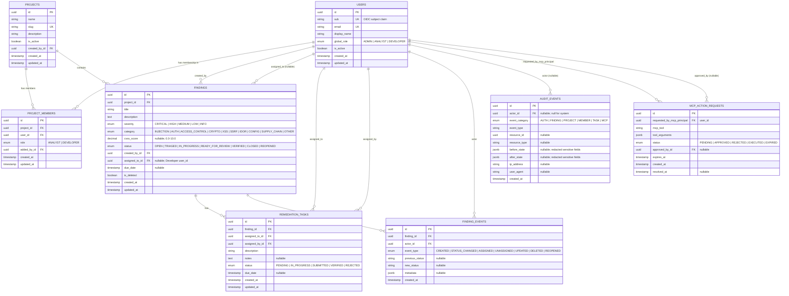
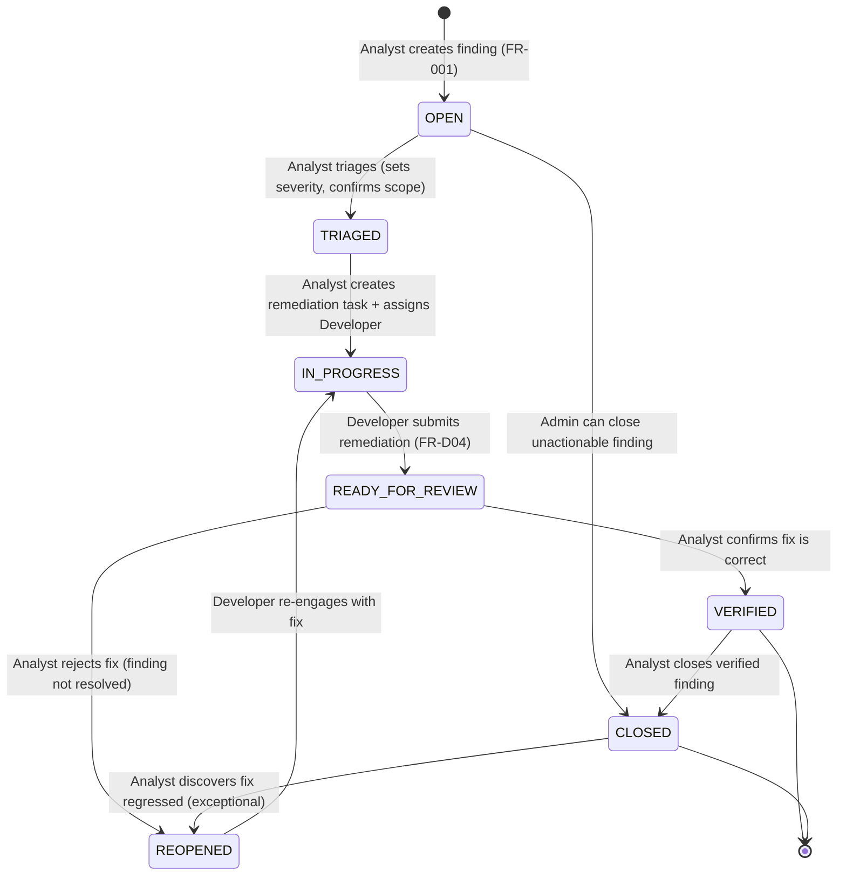

# SecureFlow — Data Model

**Document version:** 1.0 — 2026-10-15  
**Status:** Draft — pending Phase 1 gate approval  
**Related docs:** [Product Requirements §6](01-product-requirements.md) · [Architecture §4](02-architecture.md) · [Authorization Matrix](04-authorization-matrix.md) · [PROJECT_ROADMAP.md §3](../PROJECT_ROADMAP.md)

---

## 1. Entity Relationship Diagram

---

## 2. Entity Definitions

### 2.1 `users`

Stores all application users. Identity is derived from the OIDC provider; SecureFlow does not store passwords.

| Field | Type | Constraints | Notes |
|---|---|---|---|
| `id` | UUID | PK, default `gen_random_uuid()` | Internal identifier |
| `sub` | VARCHAR(255) | UNIQUE, NOT NULL | OIDC subject claim — stable user identifier from provider |
| `email` | VARCHAR(320) | UNIQUE, NOT NULL | From OIDC token `email` claim |
| `display_name` | VARCHAR(255) | NOT NULL | From OIDC `name` or `preferred_username` |
| `global_role` | ENUM | NOT NULL | `ADMIN`, `ANALYST`, `DEVELOPER` — coarse-grained; fine-grained is per-project |
| `is_active` | BOOLEAN | NOT NULL, default `true` | Soft-disable user without deleting |
| `created_at` | TIMESTAMPTZ | NOT NULL, default `now()` | |
| `updated_at` | TIMESTAMPTZ | NOT NULL, default `now()` | Updated on every write |

**Indexes:** `UNIQUE(sub)`, `UNIQUE(email)`  
**Notes:** User record is created/updated on first successful OIDC login (JIT provisioning). `global_role` may be seeded from a Keycloak realm role claim. Role changes require admin action.

---

### 2.2 `projects`

Organizes findings and team membership into logical scopes.

| Field | Type | Constraints | Notes |
|---|---|---|---|
| `id` | UUID | PK | |
| `name` | VARCHAR(255) | NOT NULL | Human-readable project name |
| `slug` | VARCHAR(100) | UNIQUE, NOT NULL | URL-safe identifier; auto-generated from name |
| `description` | TEXT | nullable | |
| `is_active` | BOOLEAN | NOT NULL, default `true` | Soft-archive a project |
| `created_by_id` | UUID | FK → users(id), NOT NULL | Admin who created the project |
| `created_at` | TIMESTAMPTZ | NOT NULL | |
| `updated_at` | TIMESTAMPTZ | NOT NULL | |

**Indexes:** `UNIQUE(slug)`, `INDEX(created_by_id)`

#### 2.2.1 Future Multi-Tenancy Migration Path
For the MVP, SecureFlow is strictly a **single-organization** platform. Rather than carrying speculative nullable columns in the initial schema, future multi-tenant SaaS capabilities will be introduced via a dedicated database migration:
1. **New `organizations` Table:** Introduce `organizations (id UUID PK, name VARCHAR(255), slug VARCHAR(100) UNIQUE, is_active BOOLEAN, created_at, updated_at)`.
2. **Backfill Default Tenant:** Seed an initial default organization record for all pre-existing single-tenant data.
3. **Foreign Key Migration:** Add `organization_id UUID NOT NULL REFERENCES organizations(id)` to `projects` (defaulting to the initial organization), and drop the default constraint post-backfill.
4. **Scope Membership & Access:** Extend `users` with an `organization_id` or junction `organization_members` table, and update `ProjectMembershipPolicy` in `packages/domain` to verify organization boundaries before evaluating project membership.

---

### 2.3 `project_members`

Junction table linking users to projects with a project-scoped role.

| Field | Type | Constraints | Notes |
|---|---|---|---|
| `id` | UUID | PK | |
| `project_id` | UUID | FK → projects(id), NOT NULL | |
| `user_id` | UUID | FK → users(id), NOT NULL | |
| `role` | ENUM | NOT NULL | `ANALYST` or `DEVELOPER` (Admin manages from global role) |
| `added_by_id` | UUID | FK → users(id), NOT NULL | Admin who added the member |
| `created_at` | TIMESTAMPTZ | NOT NULL | |
| `updated_at` | TIMESTAMPTZ | NOT NULL | |

**Indexes:** `UNIQUE(project_id, user_id)` — one membership record per user per project  
**Notes:** A user may not be both Analyst and Developer in the same project. Removing a record immediately revokes access.

---

### 2.4 `findings`

The core entity — a recorded security vulnerability.

| Field | Type | Constraints | Notes |
|---|---|---|---|
| `id` | UUID | PK | Non-sequential (UUID v4) — defense in depth against enumeration; object-level authorization is the primary IDOR control |
| `project_id` | UUID | FK → projects(id), NOT NULL | Determines access scope |
| `title` | VARCHAR(500) | NOT NULL | |
| `description` | TEXT | NOT NULL, max 10,000 chars enforced at app layer | Treated as untrusted data; never interpreted as instructions |
| `severity` | ENUM | NOT NULL | `CRITICAL`, `HIGH`, `MEDIUM`, `LOW`, `INFO` |
| `category` | ENUM | NOT NULL | See enum list in §2.4.1 |
| `cvss_score` | DECIMAL(3,1) | nullable, CHECK 0.0–10.0 | CVSS v3.1 base score |
| `status` | ENUM | NOT NULL, default `OPEN` | State machine defined in §4 |
| `created_by_id` | UUID | FK → users(id), NOT NULL | Analyst who created the finding |
| `assigned_to_id` | UUID | FK → users(id), nullable | Developer assigned; null if unassigned |
| `due_date` | DATE | nullable | Remediation due date |
| `is_deleted` | BOOLEAN | NOT NULL, default `false` | Soft deletion; records retained for audit |
| `version` | INTEGER | NOT NULL, default `1` | Optimistic concurrency control version counter; incremented on finding mutations |
| `created_at` | TIMESTAMPTZ | NOT NULL | |
| `updated_at` | TIMESTAMPTZ | NOT NULL | |

**Indexes:**
- `INDEX(project_id)` — filter findings by project
- `INDEX(assigned_to_id)` — developer's finding list
- `INDEX(status)` — filter by status
- `INDEX(project_id, status)` — composite for common list queries
- `INDEX(is_deleted)` — exclude deleted from default queries

**✅ Decision D9 (Approved):** Defer `WONT_FIX` and `DUPLICATE` as future dispositions. The MVP state machine focuses on core operational states (`OPEN`, `TRIAGED`, `IN_PROGRESS`, `READY_FOR_REVIEW`, `VERIFIED`, `CLOSED`, `REOPENED`); future dispositions will be modeled as sub-states or additional terminal statuses in post-MVP phases.

#### 2.4.1 Finding Categories

`INJECTION`, `AUTH`, `ACCESS_CONTROL`, `CRYPTO`, `XSS`, `SSRF`, `IDOR`, `INSECURE_DESERIALIZATION`, `SUPPLY_CHAIN`, `CONFIG_EXPOSURE`, `SENSITIVE_DATA`, `LOGGING`, `OTHER`

---

### 2.5 `remediation_tasks`

A concrete work item assigned to a Developer to fix a finding.

| Field | Type | Constraints | Notes |
|---|---|---|---|
| `id` | UUID | PK | |
| `finding_id` | UUID | FK → findings(id), NOT NULL | The finding this task remediates |
| `assigned_to_id` | UUID | FK → users(id), NOT NULL | Developer doing the work |
| `assigned_by_id` | UUID | FK → users(id), NOT NULL | Analyst who created the task |
| `description` | TEXT | NOT NULL | What the developer needs to do |
| `notes` | TEXT | nullable | Developer progress notes |
| `status` | ENUM | NOT NULL, default `PENDING` | `PENDING`, `IN_PROGRESS`, `SUBMITTED`, `VERIFIED`, `REJECTED` |
| `due_date` | DATE | nullable | |
| `created_at` | TIMESTAMPTZ | NOT NULL | |
| `updated_at` | TIMESTAMPTZ | NOT NULL | |

**Indexes:** `INDEX(finding_id)`, `INDEX(assigned_to_id)`  
**Notes:** One finding can have at most one active remediation task at a time (enforced at application layer; a CHECK constraint or partial unique index may be added). A rejected task allows a new task to be created.

---

### 2.6 `finding_events`

Immutable event log for finding state changes. Supports the audit view and finding history.

| Field | Type | Constraints | Notes |
|---|---|---|---|
| `id` | UUID | PK | |
| `finding_id` | UUID | FK → findings(id), NOT NULL | |
| `actor_id` | UUID | FK → users(id), NOT NULL | User who caused the event |
| `event_type` | ENUM | NOT NULL | `CREATED`, `STATUS_CHANGED`, `ASSIGNED`, `UNASSIGNED`, `UPDATED`, `DELETED`, `REOPENED` |
| `previous_status` | VARCHAR(50) | nullable | Before state for status changes |
| `new_status` | VARCHAR(50) | nullable | After state for status changes |
| `metadata` | JSONB | nullable | Additional structured context; never contains secrets |
| `created_at` | TIMESTAMPTZ | NOT NULL | Immutable; no updated_at |

**Indexes:** `INDEX(finding_id)`, `INDEX(actor_id)`, `INDEX(created_at DESC)` — supports chronological history queries  
**Notes:** Records are append-only. No `UPDATE` or `DELETE` DML is permitted on this table from application code (enforced by repository layer convention and verified in Phase 7 AppSec review).

---

### 2.7 `audit_events`

Organization-wide security audit trail covering all security-relevant operations.

| Field | Type | Constraints | Notes |
|---|---|---|---|
| `id` | UUID | PK | |
| `actor_id` | UUID | FK → users(id), nullable | null for system-initiated events |
| `event_category` | ENUM | NOT NULL | `AUTH`, `FINDING`, `PROJECT`, `MEMBER`, `TASK`, `MCP` |
| `event_type` | VARCHAR(100) | NOT NULL | e.g., `finding.status_changed`, `auth.login_success` |
| `resource_id` | UUID | nullable | The affected resource's ID |
| `resource_type` | VARCHAR(100) | nullable | e.g., `finding`, `project`, `user` |
| `before_state` | JSONB | nullable | Previous resource state; sensitive fields redacted |
| `after_state` | JSONB | nullable | New resource state; sensitive fields redacted |
| `ip_address` | INET | nullable | Client IP where available |
| `user_agent` | VARCHAR(500) | nullable | |
| `created_at` | TIMESTAMPTZ | NOT NULL | Immutable; no updated_at |

**Indexes:** `INDEX(actor_id)`, `INDEX(event_category, event_type)`, `INDEX(resource_id, resource_type)`, `INDEX(created_at DESC)`  
**Notes:** Append-only. No application-layer DELETE or UPDATE. `before_state` / `after_state` must never contain tokens, passwords, or session IDs.

#### Actual Security Guarantees (Append-Only, Application-Layer Immutability)
- **Application layer:** No `UPDATE` or `DELETE` API endpoints exist. The domain repository provides no update or delete functions for `audit_events` or `finding_events`.
- **Database layer:** The PostgreSQL application user role will be granted `INSERT` and `SELECT` only on `audit_events` and `finding_events` (no `UPDATE` or `DELETE` grants). Verified during Phase 7 AppSec review.
- **Out of scope for MVP (Not provided):** Cryptographic hash chaining (e.g., Merkle trees/HMAC chains), external write-once storage (WORM), or tamper detection against direct PostgreSQL admin/DBA modifications.
- **Residual risk:** A compromised database superuser or database host root user can modify records without detection by this mechanism. This residual risk is accepted for MVP and documented for Phase 8 release notes.
- **Verification criterion (Phase 7):** Connect to PostgreSQL using application credentials and verify that `DELETE FROM audit_events` triggers a permission denied error.

---

### 2.8 `mcp_action_requests` (Phase 6+)

Pending action proposed by an MCP client, requiring human approval before execution.

| Field | Type | Constraints | Notes |
|---|---|---|---|
| `id` | UUID | PK | |
| `requested_by_mcp_principal` | UUID | FK → users(id), NOT NULL | The user identity validated from the MCP Bearer token |
| `mcp_tool` | VARCHAR(100) | NOT NULL | e.g., `propose_remediation_task` |
| `tool_arguments` | JSONB | NOT NULL | Validated Zod-parsed arguments; no secrets |
| `status` | ENUM | NOT NULL, default `PENDING` | `PENDING`, `APPROVED`, `REJECTED`, `EXECUTED`, `EXPIRED` |
| `approved_by_id` | UUID | FK → users(id), nullable | Analyst or Admin who approved |
| `expires_at` | TIMESTAMPTZ | NOT NULL | Auto-expire pending requests after configurable TTL |
| `created_at` | TIMESTAMPTZ | NOT NULL | |
| `resolved_at` | TIMESTAMPTZ | nullable | When approved, rejected, executed, or expired |

**Indexes:** `INDEX(status, expires_at)` — for expiry sweep; `INDEX(requested_by_mcp_principal)`

---

## 3. Relationships Summary

| Relationship | Cardinality | Notes |
|---|---|---|
| User → ProjectMember | 1:many | A user may be in many projects |
| Project → ProjectMember | 1:many | A project has many members |
| Project → Finding | 1:many | A project contains many findings |
| Finding → RemediationTask | 1:many (active: 1:1) | At most one active task at a time |
| Finding → FindingEvent | 1:many | Append-only history |
| User → Finding (created_by) | 1:many | Analyst creates findings |
| User → Finding (assigned_to) | 1:many (nullable) | Developer assigned |
| User → AuditEvent (actor) | 1:many | All user actions traced |

---

## 4. Finding Status State Machine

### Transition Authorization Matrix

| Transition | From | To | Authorized Roles | Conditions |
|---|---|---|---|---|
| Create | — | OPEN | Analyst (project member) | Must be a member of the project |
| Triage | OPEN | TRIAGED | Analyst (project member) | |
| Close unactionable | OPEN | CLOSED | Admin | Rare; audit required |
| Assign + start | TRIAGED | IN_PROGRESS | Analyst (project member) | Remediation task created; Developer assigned |
| Submit remediation | IN_PROGRESS | READY_FOR_REVIEW | Developer (assignee only) | Developer must be the assigned developer |
| Verify (close) | READY_FOR_REVIEW | VERIFIED | Analyst (project member) | |
| Reject (reopen) | READY_FOR_REVIEW | REOPENED | Analyst (project member) | |
| Close | VERIFIED | CLOSED | Analyst (project member) | |
| Re-engage | REOPENED | IN_PROGRESS | Analyst (project member) | New or same remediation task |
| Force reopen | CLOSED | REOPENED | Admin only | Exceptional; always audited; aligns with [Authorization Matrix §2.2](04-authorization-matrix.md) |

> **Developer cannot self-approve:** A Developer with `submitted-remediation` cannot call `verify`. The Analyst performing verification must be a different user.

---

## 5. Transactional and Concurrency Requirements

| Operation | Transaction Scope | Isolation | Notes |
|---|---|---|---|
| Finding status change | Single transaction: update `findings.status` + insert `finding_events` row | SERIALIZABLE or `SELECT FOR UPDATE` | Prevents concurrent transitions; version field or optimistic locking in Phase 3 |
| Remediation task assignment | Single transaction: create `remediation_tasks` + update `findings.assigned_to_id` + insert event | READ COMMITTED with row lock | |
| Project member removal | Single transaction: delete `project_members` + insert audit event | READ COMMITTED | Downstream access checks must be real-time, not cached |
| Audit event write | Append-only insert; must succeed with the parent operation or roll back both | Same transaction as parent | Audit must not silently fail |
| MCP action approval/execution | Two-phase: approve → re-authorize → execute | SERIALIZABLE for the execute step | Re-check authorization at execution time, not just at proposal time |

### Optimistic Locking Strategy
Findings carry a dedicated integer `version` field (initialized to 1). Concurrent updates are detected by checking `WHERE id = ? AND version = ?` with an atomic compare-and-increment (`SET version = version + 1`) before committing — if 0 rows affected, return HTTP 409 Conflict. The `updated_at` timestamp is maintained concurrently for temporal and audit purposes, but optimistic concurrency protection relies strictly on the atomic version counter. Implement in Phase 3.

---

## 6. Data Retention and Privacy Notes

- **Findings and audit events** are retained indefinitely by default (regulatory and accountability reasons).
- **Soft deletion** (`is_deleted = true`) is used for findings; they are excluded from default queries but retained for audit.
- **`finding_events` and `audit_events`** are never deleted via application code.
- **User PII** (email, display name) is stored for operational purposes. A future GDPR/right-to-erasure feature would pseudonymize the user record, not delete audit events (which retain `actor_id` as a pseudonymized reference).
- **No real vulnerability payloads, exploit code, or production credentials** are ever stored in finding descriptions in the demo environment.

---

## 7. Database Seeding Strategy

- Seed data is **100% synthetic** — no real vulnerabilities, real usernames, or production data.
- Seed scripts produce deterministic demo users: `admin@demo.local`, `analyst@demo.local`, `dev@demo.local`.
- Seed data includes sample projects and findings across severity levels to demonstrate the UI.
- Seed scripts are run in development and test environments only; production bootstrap must be documented separately.
