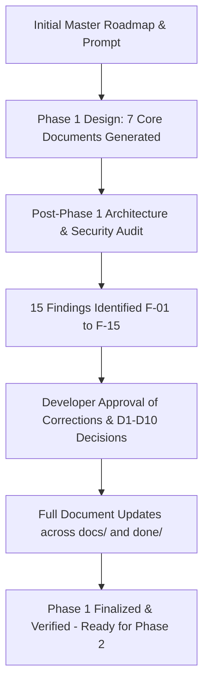

# SecureFlow — Phase 1 Final Delivery & Architecture Sign-Off Package

**Prepared by:** Antigravity AI (Google DeepMind)  
**Date:** 2026-10-15  
**Project:** SecureFlow — Security Findings & Remediation Management Platform with MCP  
**Repository:** `D:\GitProjects\secureflow-mcp-appsec-platform`  
**Purpose:** Formal, comprehensive delivery package for advisor review, detailing all work executed in Phase 1, the architecture review, approved decisions, applied corrections, and Phase 2 readiness.

---

## Package Directory Contents

| File | Audience | Purpose |
|---|---|---|
| [README.md](README.md) | Technical Advisor & Evaluator | Complete chronological and technical overview of Phase 1 from conception to sign-off |
| [PHASE1_ADVISOR_BRIEFING.md](PHASE1_ADVISOR_BRIEFING.md) | Academic / Project Advisor | Plain-language executive brief summarizing why decisions were made and why the project is ready for implementation |
| [PHASE1_CORRECTIONS_AUDIT_LOG.md](PHASE1_CORRECTIONS_AUDIT_LOG.md) | Security Reviewer / Auditor | Line-by-line verification of the 15 review findings (F-01 to F-15) and where each was resolved |

---

## 1. Executive Summary

Phase 1 of SecureFlow was dedicated strictly to **Product Definition, System Architecture, and Security Design**. In accordance with professional engineering principles, zero lines of application code, database migrations, or containers were scaffolded prematurely.

Across Phase 1, the following milestones were achieved:
1. **Foundation Scaffolding:** Comprehensive design of 7 core specifications covering product requirements, C4 architecture, PostgreSQL data model, RBAC + object-level authorization matrix, STRIDE threat model, development backlog, and an ADR.
2. **Deep Architecture & Security Review:** A systematic audit covering 12 areas that uncovered 15 specific findings (including a critical MCP transport deprecation and security claim inaccuracies).
3. **Formal Architectural Resolution (D1–D10):** Alignment and approval of 10 key technical decisions (Prisma 7 with driver adapter, Keycloak OIDC, BFF session model, Streamable HTTP transport, etc.).
4. **Complete Documentation Rectification:** Updating all 7 specifications to resolve every finding and integrate all approved decisions without touching the original roadmap files.

**Verdict: UNCONDITIONAL GO FOR PHASE 2.**

---

## 2. Chronological Summary of What Was Done

### Stage 1: Design Generation
The initial master roadmap (`PROJECT_ROADMAP.md`) and instructions (`ANTIGRAVITY_FIRST_PROMPT.md`) were analyzed to construct the complete foundational design in `docs/`:
- `01-product-requirements.md` (Vision, roles, 17 user stories, 28 functional requirements, 15 ASVS security requirements)
- `02-architecture.md` (Modular monolith, C4 system & container diagrams, trust boundaries, BFF session, MCP model)
- `03-data-model.md` (ERD, 8 entity schemas, finding status machine, concurrency & audit guarantees)
- `04-authorization-matrix.md` (RBAC × action matrix, 12 object invariants, 15 negative authorization test cases)
- `05-threat-model.md` (STRIDE analysis with 34 reconciled threats: 30 STRIDE threats across 6 categories plus 4 supply chain/CI controls, mitigations, ASVS mapping)
- `06-backlog-and-acceptance.md` (Phase 1–8 breakdown, acceptance criteria, phase gates)
- `decisions/0001-modular-monolith.md` (ADR justifying modular monolith over microservices)

### Stage 2: Independent Review & Audit
A rigorous audit was conducted on the generated specifications to ensure accuracy and real-world compatibility before any code was written. This revealed 15 findings:
- **1 Critical (F-01):** The MCP transport specification was using deprecated HTTP+SSE instead of the modern **Streamable HTTP** transport.
- **3 High (F-02, F-03, F-04):** UUIDs were overstated as "preventing IDOR" (corrected to defense-in-depth, establishing object-level authorization as primary); audit logs were overstated as "tamper-evident" (corrected to append-only application-layer immutability, noting DB admin access as an accepted residual risk); BFF session security needed documentation of XSS co-dependencies and dynamic real-time project membership resolution.
- **7 Medium (F-05 to F-11):** Split decision register (8 vs 10); unpinned stack versions; MCP OAuth 2.1 / RFC 9728 discovery omitted; direct repository import bypass risk; missing `organization_id` in project ERD; status transition role conflict on force-reopen; deferred API and frontend contract specifications.
- **4 Low (F-12 to F-15):** Orphaned `COMMENTED` enum; Admin finding creation clarification; OLI-8 role wording; mitigation ordering in threat model.

### Stage 3: Decision Approvals (D1–D10)
The developer formally reviewed the audit and approved the 10 architecture decisions:
- **D1 (ORM):** Prisma 7 with official PostgreSQL driver adapter (`@prisma/adapter-pg`).
- **D2 (OIDC Provider):** Keycloak 26.x running in Docker Compose for local development.
- **D3 (Session Architecture):** BFF (Backend For Frontend) server-managed session with HttpOnly/Secure/SameSite=Lax cookies and session rotation.
- **D4 (Developer Visibility):** Assigned findings only (least privilege).
- **D5 (MCP Transport):** Streamable HTTP using the official TypeScript SDK v2 (`@modelcontextprotocol/express`) and OAuth 2.1.
- **D6 (Live Deployment):** Defer public deployment; local Docker Compose + video demo for portfolio.
- **D7 (License):** MIT License (file creation at release).
- **D8 (MCP Client):** MCP Inspector for testing + Claude Desktop for real-client integration demo.
- **D9 (Extended Statuses):** Defer `WONT_FIX` and `DUPLICATE` as future dispositions; keep core state machine focused for MVP.
- **D10 (Multi-Tenancy):** Single-organization MVP (no speculative `organization_id` column; clean future multi-tenancy migration path formally documented in data model).

### Stage 4: Execution of Corrections
All 7 design documents in `docs/` and the reports in `done/` were edited in place using targeted replacements to integrate all 15 findings and 10 decisions cleanly.

---

## 3. Authoritative Document Map

All project documentation is located in the repository under:
- `docs/01-product-requirements.md`
- `docs/02-architecture.md`
- `docs/03-data-model.md`
- `docs/04-authorization-matrix.md`
- `docs/05-threat-model.md`
- `docs/06-backlog-and-acceptance.md`
- `docs/decisions/0001-modular-monolith.md`
- `done/PHASE1_SUMMARY_FOR_ADVISOR.md`
- `done/PHASE1_REVIEW_SUMMARY_FOR_ADVISOR.md`
- `done/phase1_final_delivery/` (this package)

The master instructions `ANTIGRAVITY_FIRST_PROMPT.md` and roadmap `PROJECT_ROADMAP.md` remain completely unmodified at the project root.
